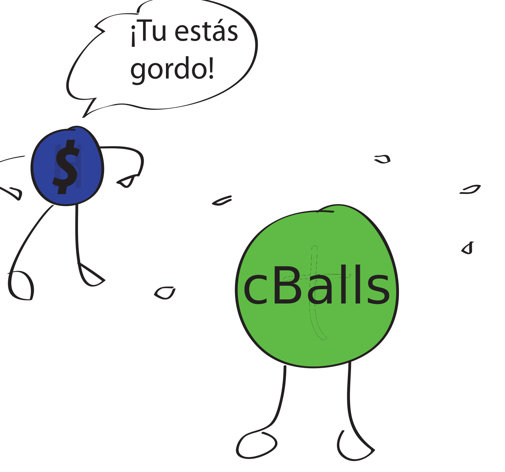

<p align="left">

This update targets `testing/current-state-2026-08-30`. The branch contains only
the enabled addon profile, with required shared kernels under `support/` and all
Python benchmarks under `tests/python/` and regressions under `tests/python/`. See the
[active profile](docs/ACTIVE_PROFILE.md) for its 41 methods and directory list.
The main branch is unchanged; merging follows a separate full validation.

    
</p>

# cTreeBalls: Correlation functions computation with Tree/Balls methods

Author: Mario A. Rodriguez-Meza

Major contributors:

- [Alejandro Aviles](https://github.com/alejandroaviles)
- [Eladio Moreno](https://github.com/Eladio-Moreno)
- [Gustavo Niz](https://github.com/gnizq64)
- [Sadi Ramirez](https://github.com/sadirs)
- Axel Romero Tisnado
- Sofia Samario


## Introduction

**cTreeBalls 1.1.0** provides the C executable `cballs`, the static library
`libcballs.a`, and the Python extension `cyballs`. Optional addons measure:

- Counts and convergence: scalar angular 2PCF/3PCF on flat or spherical catalogs.
- Shear: full-sky spin-2 correlations, parallel transport, and angular window
  correction over octree, KD-tree, and ball-tree dual-node traversals.
- Lyman-alpha forests: anisotropic 3D and radial-only 2PCF/3PCF with
  forest-ID exclusions, octree-discovered LOS trees, and an equal-LOS radial 2PCF.
- Physical 3D scalar fields and ENCORE-style data/random survey estimators.

OpenMP and MPI availability depends on the selected build. Not every engine
accepts every geometry, field, mask, or normalization.

## Interactive scientific tutor

Run `./cballs options=IA-tutor` to ask about engines, approximation penalties,
normalization, MPI, timing and plots. The default offline mode searches local
documentation and reviewed scientific explanations from the development
questions, with source references. It needs Python 3.9+ and no model download.
An already installed local Ollama model is optional. See
[the tutor guide](docs/ia_tutor.rst) for conversation commands, catalogue header
inspection, saved error reports and configuration.

```sh
./cballs options=IA-tutor
./cballs options=IA-tutor --ask "Does bin theta override tree theta?"
```

## Documentation

- [Sphinx guide](https://ctreeballs.readthedocs.io/en/latest/)
- [Installation](docs/installation.rst) and [build profiles](docs/build_profiles.rst)
- [Search-method guide](docs/search_methods.rst)
- [Active capability catalog](ENGINE_CAPABILITIES.md) and [validation rules](docs/capabilities.rst)
- [Scalar numerical definitions](docs/3pcf.rst)
- [Python API](docs/api.rst) and [in-memory catalogs](docs/user/python.rst)
- [Benchmarking](docs/benchmarks.rst) and [regressions](tests/python/README_regression_tests.md)

These source docs describe this checkout. Published packages and hosted docs
may lag behind local changes; uploading source does not publish a PyPI release.

## Build and Install

Work inside a Python virtual or Conda environment. Native builds need a C
compiler, OpenMP support for the OpenMP engines, make, ar, Python development
headers, and zlib. Enabled MPI addons additionally require an MPI C compiler
and runtime, normally `mpicc` and `mpiexec`.

```sh
git clone https://github.com/rodriguezmeza/cTreeBalls.git
cd cTreeBalls
python3 -m pip install -r requirements/build.txt
make -j4 cballs cyballs-static-lib
CBALLS_STATIC_LIBRARY_READY=1 python3 setup.py build_ext --inplace --force
```

The last command is a checkout build, not a package installation. Use
`CBALLS_STATIC_LIBRARY_READY=1` only immediately after building the static
library with the same profile. To install this checkout in the active environment:

```sh
python3 -m pip install .
```

To install a published PyPI release, use `python3 -m pip install cyballs`.
The project name is cTreeBalls; both the distribution and import names are
`cyballs`, matching `setup.py`. A pip installation does not install the
checkout's `cballs` command, examples, or benchmark source trees.

Configure `Makefile_settings`, `Makefile_machine`, and
`addons/Makefile_addons_settings` before building. Source archive creation sets
its staged defaults to external GSL and CFITSIO (`GSLINTERNAL=0`,
`CFITSIOLIBON=0`), discovered with `gsl-config` and `pkg-config cfitsio`.
It preserves the development checkout's settings. Bundled-library sources are
not included in the archive. See [source artifact verification](docs/SOURCE_DISTRIBUTION.md). Keep C and Cython
flags identical and rebuild both after changing a profile. Do not hand-edit
the generated `python/ccyballs.pxd`.

## Discover and Run

From the checkout root:

```sh
./cballs --help
./cballs options=make-info
./cballs options=print-options
./cballs options=print-search-methods
./cballs search=octree-2balls-omp nbody=512 sizeHistN=6 mChebyshev=3 \
    numberThreads=2 rootDir=Output_quick verbose=0 verbose_log=0
```

`make-info` reports the settings embedded in the executable, not merely the
current Makefiles. `print-search-methods` lists registered methods and their
requirements. Save the used-values file and build information with each run.

For scalar angular 3PCF in 3D, use observer-centered positions and Euclidean
chord bins. On a unit sphere, a separation angle `alpha` has chord length
`2*sin(alpha/2)`. **Do not recenter a sky catalog.**

The shared raw benchmark definition uses
`options=no-normalize-HistZeta,weights-norm` and ordered distinct triplets.
Repeated neighbors are removed inside the search. See the
[3PCF definition](docs/3pcf.rst) for complex-mode conventions and normalization.
Older affected multipoles must be recomputed.

`SMOOTHPIVOTON=1` compiles pivot smoothing on engines that advertise support
through `options=print-search-methods`. Smoothing is off by default;
`options=smooth-pivot` explicitly selects the smoothed estimator. Native octree scalar dual node mode
retains body pivots; its `legacy-one-ball` compatibility mode supports smoothing.
Validate approximate tree acceptance against exact small-catalog runs before
interpreting speedups.

## Python and Notebooks

Register a catalog already in memory:

```python
import numpy as np
from cyballs import cballs

rng = np.random.default_rng(123)
xyz = rng.normal(size=(128, 3))
xyz /= np.linalg.norm(xyz, axis=1)[:, None]
model = cballs()
try:
    model.set(searchMethod="octree-2balls-omp", rootDir="Output_memory",
              rangeN=1.0, rminHist=0.05, sizeHistN=6, mChebyshev=3,
              numberThreads=2, useLogHist=True,
              options="no-normalize-HistZeta,weights-norm,no-one-ball,no-smooth-pivot")
    model.set_catalog(xyz, kappa=rng.normal(size=len(xyz)))
    model.Run()
    xi = model.getHistXi2pcf()
    cc, ss, sc, cs = [model.getHistZetaMsincos(2, t) for t in range(1, 5)]
    zeta_m1 = cc + ss + 1j*(sc-cs)
finally:
    model.clean_all()
```

Getters return NumPy copies. Registration retains prepared NumPy arrays;
each run copies them into C-owned storage. This avoids repeated file reads,
not all memory copies. Use `struct_cleanup()` between engines to retain
registered catalogs, and `clean_all()` when finished.

Ready-to-use examples:

Comparison drivers and their README files are in `tests/python`; `python/`
contains the Cython bindings only. The public profile excludes disabled addon
directories and `addons/python_env`. Required internal kernels live in shared
support directories and do not register extra search methods.

- [In-memory Python example](examples/cyballs_in_memory_catalog.py) and
  [notebook](examples/cyballs_in_memory_catalog.ipynb)
- [Kappa all-engines driver](tests/python/README_kappa_corr_all_engines.md):
  FITS/NPZ input, masks, complex edge corrections, OpenMP/MPI, and
  ordinary/flattened 3PCF plots
- [Forest all-engines driver](tests/python/README_lya_corr_all_engines.md) and
  [notebook](examples/lya_corr_all_engines.ipynb)
- [Shear all-engines driver](tests/python/README_shear_corr_all_engines.md),
  including opt-in, separately calibrated octree/ball-tree pivot reuse
- [Physical 3D/ENCORE comparison](examples/compare_octree_3pcf_3d_encore.py)
  and [notebook](examples/compare_octree_3pcf_3d_encore.ipynb)

MPI Python runs require `mpi4py` linked to the same MPI implementation.
Every rank must enter the same run and cleanup sequence; read published
histograms on rank 0. The all-engines drivers manage catalog broadcasting.
Native benchmark CPU time is summed across participating MPI ranks; wall time
is the slowest rank. Save the per-rank timings and numerical settings alongside
results. The `mainloop_*` table columns exclude the collection of run information in Python;
`compute_*` includes the complete `Run` call. Compare matching timing scopes.
See `scripts/benchmark_accuracy_and_timing.py` for cold-process timing, memory and retained
accuracy workloads. Exact native-octree 3PCF needs `no-one-ball,no-smooth-pivot`; scheduling
with `BALLS4SCANLEVON=1` can remain enabled.

## Tests and Documentation Builds

The documentation toolchain requires Python 3.11 or newer.

```sh
make test-make-info test-search-methods
python3 -m pytest -q tests/python/test_scalar_numerical_definitions.py
CBALLS_TEST_MPI=1 mpiexec -n 2 python3 tests/python/test_scalar_numerical_definitions.py
python3 -m pip install -r docs/requirements.txt
python3 -m sphinx -E -a -n -W --keep-going -b html docs docs/_build/html
```

Scalar numerical tests require a matching scalar C/Cython profile; MPI checks
also require the MPI siblings and mpi4py. Repeat with both smoothing build
settings. The main CI workflow covers profile-specific C/Cython, packaging,
MPI, and sanitizer jobs. Small correctness tests are not full-sky timing claims.

Open `docs/_build/html/index.html` after the Sphinx build. Additional plotting
notebooks are maintained in
[CBalls_plots](https://github.com/joar-cafe/CBalls_plots/tree/main/benchmarks).

## License

**cBalls** is written by Mario A. Rodriguez-Meza, is open source and distributed under the [MIT license](LICENSE). If you use this program in research work that results in publications, please cite the following paper:

Abraham Arvizu et al., [arXiv:2408.16847](https://arxiv.org/abs/2408.16847)

## Checks for the selected build

See [Release work sequence](RELEASE_WORK_SEQUENCE.md) for exact-profile release checks,
resource forecasts, held-out accuracy qualification, owned forest/physical result
APIs, and matching-science scaling benchmarks.


Physical survey corrections are now retained by the Python model, independently
of output files. See [survey result semantics](docs/physical_survey_semantics.rst)
for signal/window bandwidths, solve padding, validity, diagnostics and the
required exact-reference science campaign. Fast defaults remain unchanged;
passing software checks does not qualify rejected scientific results.

## Engineering and repeatable measurements

See [engineering contracts](docs/engineering_contracts.rst) for native concurrency,
configuration ownership, acceptance policy, platform/version CI coverage and the
correctness-gated dedicated-node benchmark workflow. Local smoke measurements
are labeled explicitly and do not certify dedicated-node performance.

See [the approximation defaults and 5% L2 criterion](docs/APPROXIMATION_DEFAULTS.md) for fast defaults, measured penalties, exact references, and the limits of finite-multipole reconstruction.

## Perlmutter CPU batch jobs

[Perlmutter job scripts](tests/slurm_scripts/README.md) cover every registered
MPI and OpenMP engine, with shared input/output handling, saved run settings,
approximation guidance, a scaling sweep and cross-node numerical checks.

## Acknowledgments

cBalls use/is based on the following codes or projects:
-   [Zeno](https://home.ifa.hawaii.edu/users/barnes/zeno/index.html)
-   [Gadget-2](https://wwwmpa.mpa-garching.mpg.de/gadget/)
-   [CUTE](https://github.com/damonge/CUTE)
-   [Numerical Recipes](https://numerical.recipes/)
-   [GSL](https://www.gnu.org/software/gsl/)
-   [CLASS](https://github.com/lesgourg/class_public)
-   [CFITSIO](https://heasarc.gsfc.nasa.gov/fitsio/fitsio.html)
-   [HEALPix](https://healpix.sourceforge.io/)
-   [FCFC](https://github.com/cheng-zhao/FCFC)
-   [TreeCorr](https://github.com/rmjarvis/TreeCorr)

Also author acknowledges for helpful discussion and testing to the following people:

- Abraham Arvizu
- Alejandro Aviles
- Juan Carlos Hidalgo
- Eladio Moreno
- Gustavo Niz
- Axel Romero Tisnado
- Sofia Samario

We acknowledge financial support from SECIHITI grants CBF2023-2024-162 and CBF-2025-I-2795.
